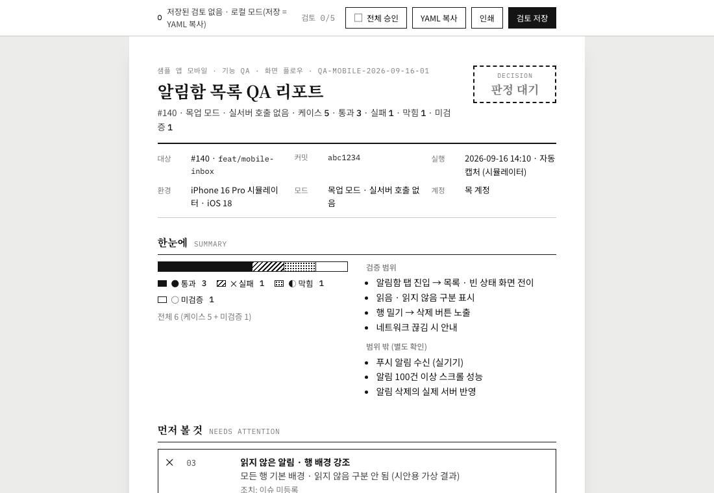
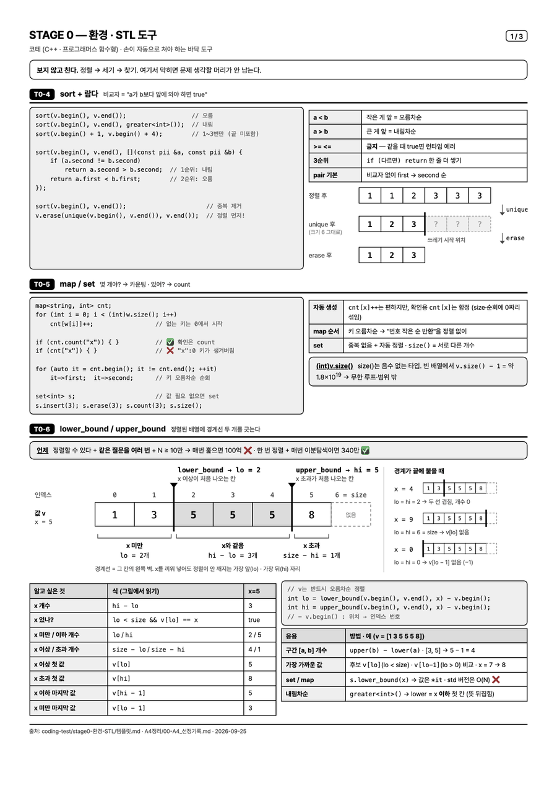
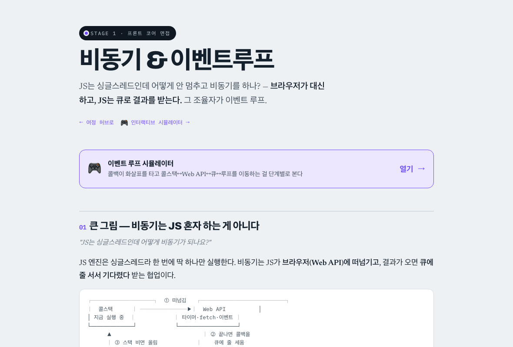

# 스킬 사용 예시

스킬마다 **언제 쓰는지 · 어떻게 부르는지 · 무엇이 나오는지**를 한 페이지로 정리했다. 모든 예시는 가상 앱 "습관 기록" 하나를 배경으로 한다.

학습 스킬 두 개(`a4-study-sheet`, `study-explainer`)는 `dong-study` 플러그인, 나머지는 `dong-skills` 플러그인에 들어 있다. 설치 방법은 [README](../README.md#설치).

## 결과물이 화면으로 나오는 스킬

| | 스킬 | 무엇이 나오나 |
| --- | --- | --- |
|  | [qa-report](skills/qa-report.md) | 사람이 승인 · 반려하는 QA 리포트. 캡처 확대 보기, GIF 캡처 재생, A4 PDF |
|  | [a4-study-sheet](skills/a4-study-sheet.md) | 시험 · 면접 직전에 들고 볼 흑백 A4 한 장. diagram-design 원칙으로 그린 흑백 그림 포함 |
|  | [study-explainer](skills/study-explainer.md) | 처음 보는 사람도 이해하는 학습용 HTML |

## 글로 나오는 스킬

| 스킬 | 언제 | 무엇이 나오나 |
| --- | --- | --- |
| [choosing-doc-type](skills/choosing-doc-type.md) | 문서를 쓰기 전 | 유형 판정과 문서 세트 |
| [doc-structure-review](skills/doc-structure-review.md) | 초안 목차가 나온 뒤 | 원칙별 진단 + 통합 개선 목차 |
| [doc-sentence-polish](skills/doc-sentence-polish.md) | 문장을 다듬을 때 | 원칙별 피드백 + 수정안 하나 |
| [explaining-with-domain-context](skills/explaining-with-domain-context.md) | 코드 · 플로우를 설명할 때 | 문제 → 인과 플로우 → 결정 이유 순서의 설명 |
| [daily-scrum](skills/daily-scrum.md) | 매일 스크럼 전 | 스크럼 셀에 붙일 평문 메모 |

## 시나리오

- [문서 하나를 끝까지: 유형 결정 → 구조 리뷰 → 문장 윤문](scenarios/doc-pipeline.md)

## 예시 이미지 다시 만들기

이미지는 [`scripts/capture-docs.py`](../scripts/capture-docs.py)로 만든다. playwright(chromium)와 Pillow가 필요하다.

```bash
python scripts/capture-docs.py qa
python scripts/capture-docs.py study --a4 <A4 요약 HTML> --explainer <학습 페이지 HTML> --a4-fig <그림 있는 A4 HTML> --redact "<지울 문구>"
```

`qa`는 가상 알림함 화면([`scripts/fixtures/inbox-mock.html`](../scripts/fixtures/inbox-mock.html))으로 `skills/qa-report/example/captures/`를 다시 찍고, 예시 리포트를 빌드해 스크린샷과 GIF를 만든다.
