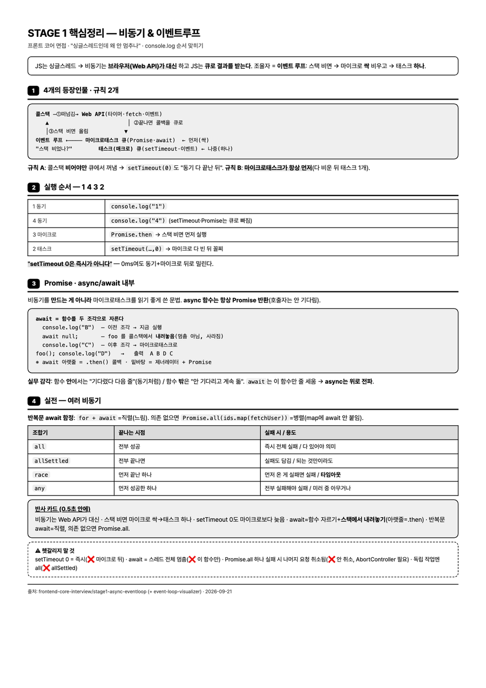

# a4-study-sheet

공부한 내용을 **시험·면접 직전에 손에 들고 볼 흑백 A4 한 장**으로 줄인다. 결과는 인쇄용 HTML이고, 브라우저에서 바로 인쇄하면 된다.

## 언제 쓰나

- **면접 직전 5분.** 한 주 동안 공부한 주제를 한 장에 모아, 대기실에서 훑어볼 때.
- **흑백 프린터로 뽑을 치트시트.** 색으로 구분하지 않고 굵기 · 테두리 · 점선으로 구분하므로 흑백으로 뽑아도 읽힌다.
- **긴 학습 자료의 마지막 정리.** [study-explainer](study-explainer.md)로 만든 긴 설명 페이지를 한 장으로 압축할 때.

## 이렇게 부른다

```
오늘 공부한 이벤트 루프 내용 A4 한 장으로 정리해줘
```
```
면접 전에 볼 거라 흑백으로 인쇄할 커닝페이퍼 만들어줘
```

## 결과 예시

"비동기 & 이벤트 루프" 주제를 한 장으로 만든 결과다. 맨 위 한 줄 정의 박스, 번호 붙은 섹션 4개, 마지막 "반사 카드"(0.5초 안에 답할 문장)와 점선 "헷갈리지 말 것" 박스로 끝난다.



같은 주제의 긴 설명 페이지는 [study-explainer 결과 예시](study-explainer.md#결과-예시)에 있다. 긴 버전으로 이해하고, 이 한 장으로 복습하는 짝이다.

## 저장 위치

1. 사용자가 위치를 지정하면 거기에 쓴다.
2. 학습 정리 저장소에서 작업 중이면 그 주제 폴더의 `A4정리/`에 모은다.
3. 그 외에는 현재 작업 폴더의 `A4정리/<주제>_핵심정리.html`.

같은 폴더에 이미 만든 시트가 있으면 새로 디자인하지 않고 그 CSS를 가져와 톤을 맞춘다.

## 쓰지 않는 경우

- 화면에서 볼 인터랙티브 학습 자료: [study-explainer](study-explainer.md)
- 색을 쓰는 대시보드나 발표 자료
