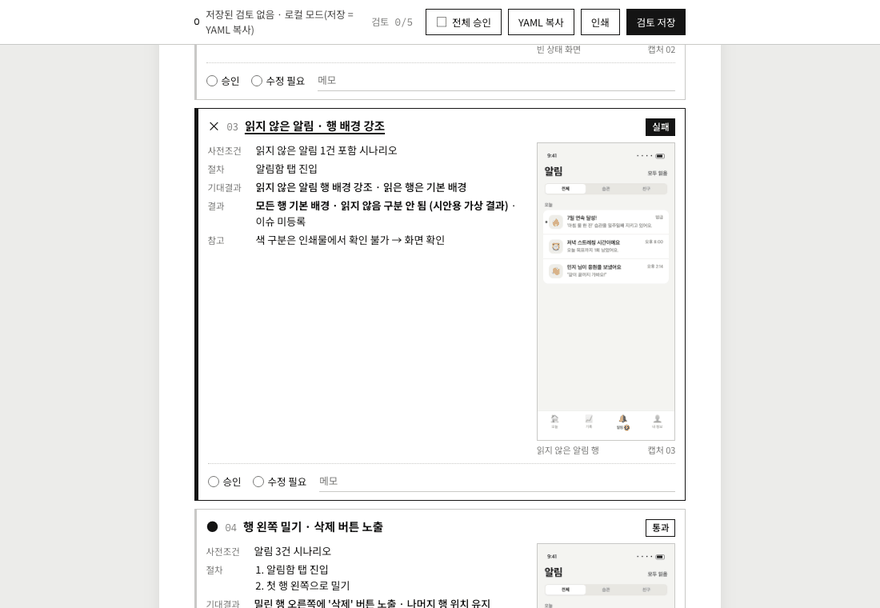
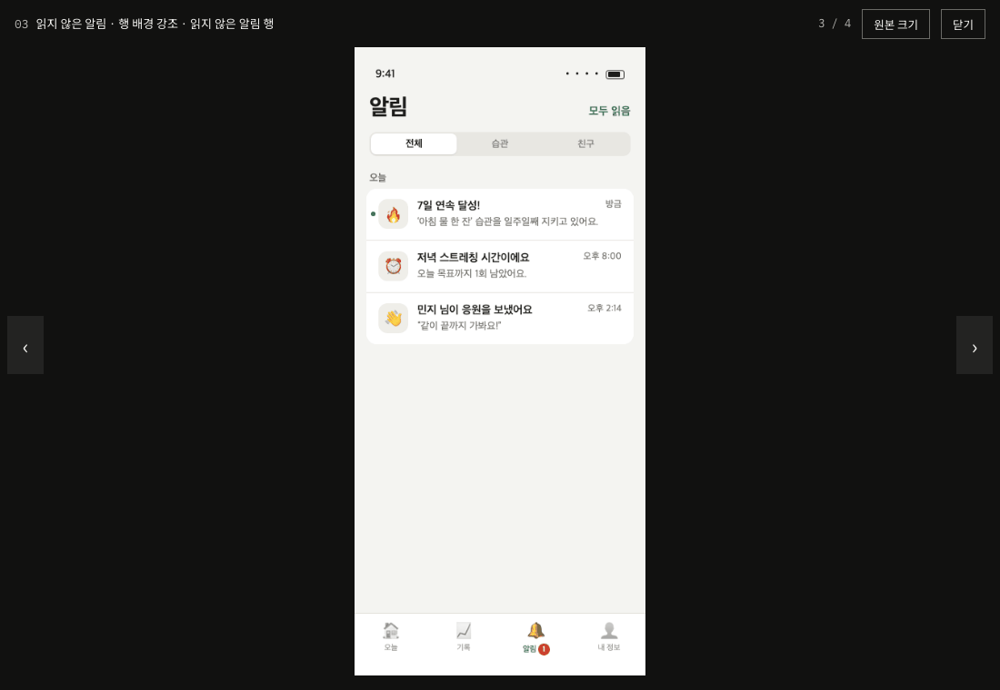
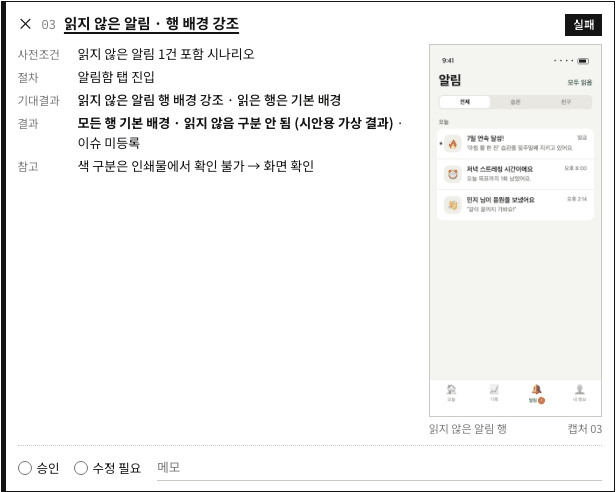
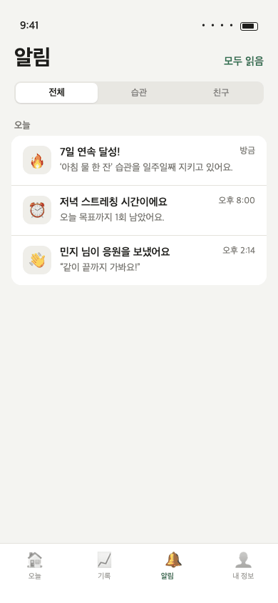
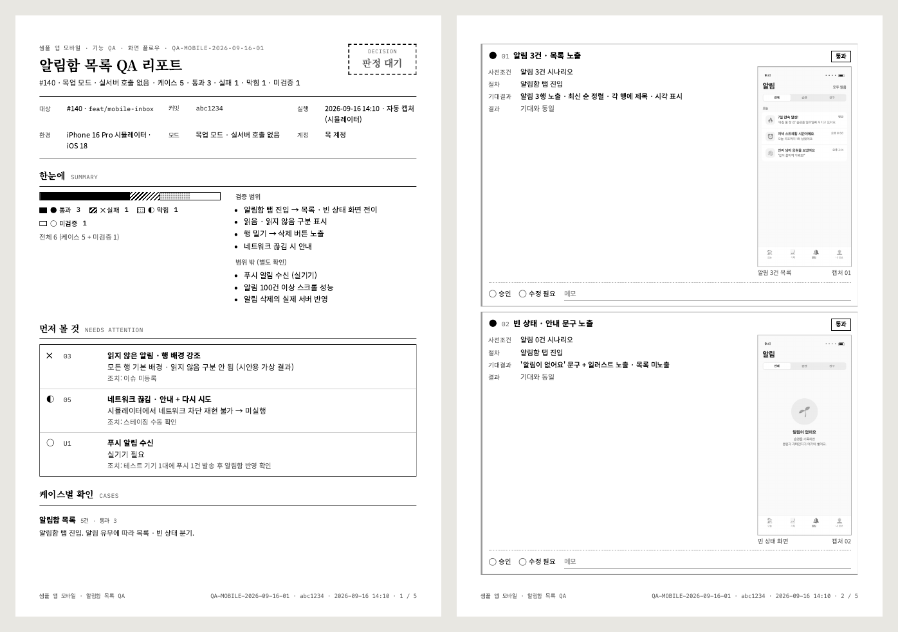

# qa-report

화면 캡처와 테스트 케이스를 **사람이 승인·반려하는 QA 리포트**로 만든다. 에이전트는 `report.json`을 쓰고, `build.py`가 화면용·A4 인쇄용 리포트를 그린다. 검토자가 "검토 저장"을 누르면 `review.yaml`이 생기고, 에이전트는 그 파일만 읽어 후속 수정을 한다.

```
report.json  ──build.py──▶  index.html (사람이 판정)  ──검토 저장──▶  review.yaml (에이전트가 읽음)
```

## 언제 쓰나

- **PR 올리기 전 화면 검수.** 새 화면을 시뮬레이터나 브라우저에서 캡처한 뒤, 리뷰어가 캡처와 기대결과를 나란히 보고 승인하게 할 때.
- **기획·디자인에 결과 공유.** 코드를 모르는 사람도 "알림 3행 노출 · 최신 순 정렬"처럼 화면에서 보이는 말로 확인할 수 있다.
- **반려 받은 항목만 고치기.** 검토자가 `수정 필요`로 표시한 케이스만 `review.yaml`에서 골라 작업한다.

## 이렇게 부른다

```
알림함 화면 캡처 4장 찍어 둔 거 QA 리포트로 정리해줘
```
```
방금 만든 회원가입 플로우, 시뮬레이터로 돌려 보고 검수 문서 만들어줘
```
```
QA 리포트 검토 끝났어. review.yaml 읽고 수정 필요한 것만 고쳐줘
```

## 결과 예시

아래 이미지는 레포의 [`example/report.json`](../../skills/qa-report/example/report.json)을 그대로 빌드한 결과다. 캡처는 가상 "습관 기록" 앱의 알림함 화면([`scripts/fixtures/inbox-mock.html`](../../scripts/fixtures/inbox-mock.html))이다.

### 화면에서 판정하기

캡처를 누르면 확대 보기가 열리고, 화살표로 다음 캡처로 넘어간다. 04번 케이스처럼 **움직임이 기대결과인 케이스는 GIF 캡처**를 넣으면 확대 보기 안에서 그대로 재생된다. 상단의 "전체 승인"을 켜면 모든 케이스와 최종 판정이 한 번에 승인으로 채워진다.



| 첫 화면 | 확대 보기 |
| --- | --- |
|  |  |

### 실패 케이스 한 장

케이스마다 사전조건 · 절차 · 기대결과 · 결과가 개조식으로 들어가고, 오른쪽에 캡처가 붙는다. 실패는 관찰한 사실만 적는다.



### GIF 캡처

밀기 · 화면 전환 · 로딩처럼 정지 화면으로는 판정할 수 없는 케이스에 쓴다. 인쇄물에는 첫 장면만 찍히므로 케이스의 `checks`에 그 사실을 한 줄 남긴다.



```json
{
  "id": "inbox.swipe",
  "no": "04",
  "title": "행 왼쪽 밀기 · 삭제 버튼 노출",
  "status": "pass",
  "steps": ["알림함 탭 진입", "첫 행 왼쪽으로 밀기"],
  "expect": "밀린 행 오른쪽에 '삭제' 버튼 노출 · 나머지 행 위치 유지",
  "actual": "기대와 동일",
  "checks": ["움직임 캡처 · 인쇄물에는 첫 장면만 → 화면에서 재생"],
  "evidence": { "src": "captures/04-inbox-swipe.gif", "alt": "첫 행 밀기 동작 (움직임 캡처)", "orientation": "portrait" }
}
```

### A4 인쇄

`--pdf`로 빌드하면 흑백 A4 PDF가 함께 나온다. 1쪽은 요약과 "먼저 볼 것", 2쪽부터 케이스별 확인이다. 쪽마다 바닥글에 리포트 ID와 쪽 번호가 찍힌다.



### 검토 결과 (review.yaml)

```yaml
report: QA-MOBILE-2026-09-16-01
commit: abc1234
seq: 1
at: "2026-09-16 15:02"
by: 검토자 이름
decision: approved_with_risk
cases:
  inbox.unread:
    no: "03"
    verdict: fix
    memo: 읽지 않은 행 배경 강조 누락 · 색 대비 확인 필요
pending: []
note: U1은 실기기 확보 후 확인
```

에이전트는 `verdict: fix`인 `inbox.unread`만 고친다. 렌더된 `index.html`은 읽지 않는다.

## 직접 돌려 보기

```bash
python3 skills/qa-report/build.py skills/qa-report/example/report.json --out /tmp/qa --pdf
```

lint가 문체를 검사한다. `~다` 서술체, 코드 식별자(`bg-gray-150`, `===`), "확인 필요" 같은 판단 표현이 사람용 칸에 있으면 빌드가 멈춘다. 필드 명세는 [reference.md](../../skills/qa-report/reference.md).

## 쓰지 않는 경우

- 단위 테스트 결과 요약: 사람이 화면을 보고 판정할 게 없으면 리포트가 필요 없다.
- 그날 한 일을 팀에 공유: [daily-scrum](daily-scrum.md). 리포트 링크는 스크럼 항목 아래에 붙인다.
