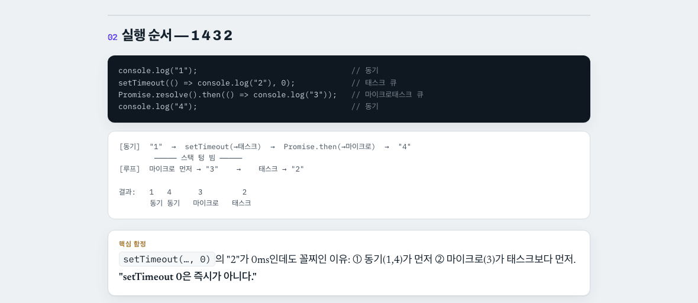

# study-explainer

개념 하나를 **그 주제를 오늘 처음 보는 사람도 이해하도록** 설명하는 학습용 HTML을 만든다. 대화 내용을 예쁘게 옮기는 게 아니라, 대화에서 생략된 배경 · 전제 · "왜"를 채우고 비유와 그림을 붙인다.

> 플러그인: `dong-study`. 설치는 [README](../../README.md#설치).

## 언제 쓰나

- **공부한 걸 복습 자료로 남길 때.** 대화로 이해한 내용은 맥락이 빠져 있어서, 일주일 뒤에 다시 보면 안 읽힌다.
- **남에게 설명할 자료가 필요할 때.** 팀원 온보딩용 개념 페이지, 스터디 발표 자료.
- **용어의 벽을 넘을 때.** 선행 개념(예: 콜스택, 큐)을 먼저 한 입 크기로 풀어 주고 본론으로 간다.

## 이렇게 부른다

```
방금 얘기한 이벤트 루프, 처음 보는 사람도 알게 HTML로 정리해줘
```
```
CORS를 비유랑 그림 넣어서 쉽게 설명한 페이지 만들어줘
```

## 결과 예시

"비동기 & 이벤트 루프" 페이지다. 맨 위에 한 줄 요약("브라우저가 대신 하고, JS는 큐로 결과를 받는다")을 두고, 섹션마다 질문 → 설명 → 그림 순서로 간다.


본문 섹션 하나. 코드 → 실행 순서 그림 → "핵심 함정" 박스로, 왜 `setTimeout(…, 0)`이 꼴찌로 실행되는지를 눈으로 보여 준다.



모든 페이지는 아래 뼈대를 지킨다. 2번(왜)과 3번(전제)은 생략하지 않는다.

```
1. 한 줄 요약
2. 왜 필요한가       이 개념이 없을 때의 문제
3. 알아둘 전제       선행 개념을 한 입 크기로
4. 핵심 메커니즘     비유 + 그림 필수
5. 트레이드오프      언제 뭘 고르나 (해당되면)
6. 한 장 정리
```

발행 전에 "이 대화를 안 본 사람이 페이지만 읽고 이해되는가"를 체크리스트로 점검한다.

## 쓰지 않는 경우

- 인쇄해서 들고 볼 한 장 요약: [a4-study-sheet](a4-study-sheet.md)
- 우리 코드의 동작 설명: [explaining-with-domain-context](explaining-with-domain-context.md)
- 대시보드 · 랜딩 페이지처럼 가르치는 목적이 아닌 HTML
